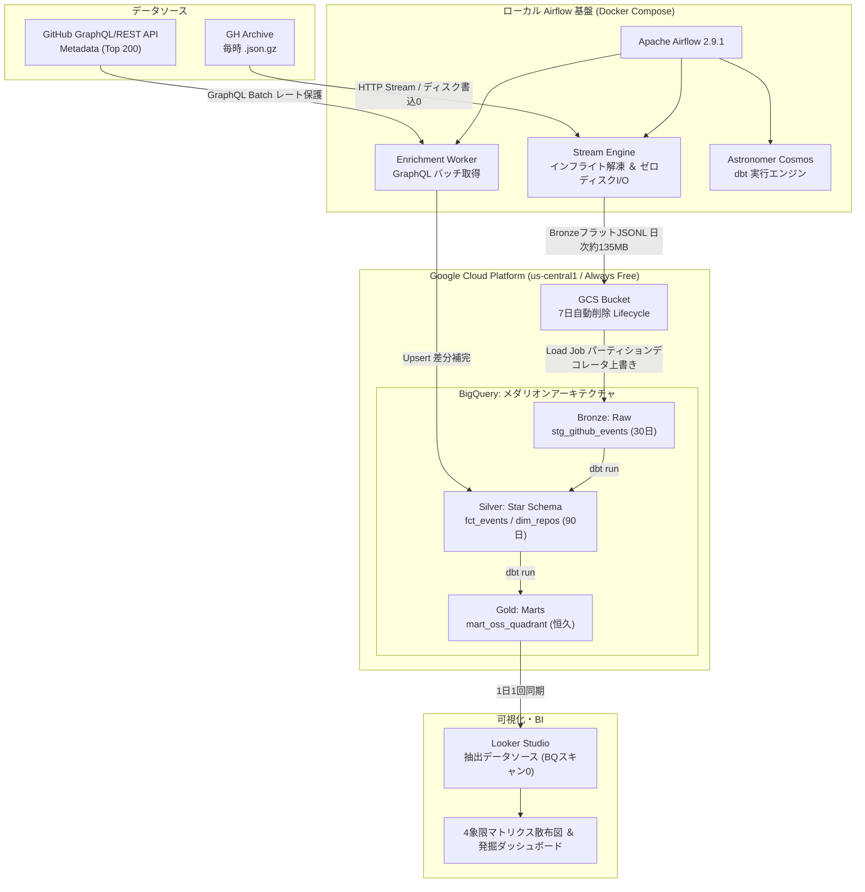

# OctoPulse: 未知の新星OSS発掘レイクハウス 🐙⚡️

[English](README.md) | 日本語

GitHub Archive の膨大な公開イベントから、**突如バズを起こした急浮上リポジトリ（未知の新星OSS）を早期検知・発掘**するためのデータレイクハウス基盤です。

単なる累計Star数ではなく、オープンソース指標標準「**CHAOSS**」に基づき、**「Attention Velocity（注目の拡散力）」×「Engagement Depth（実利用・開発定着度）」**の2軸によるパーセンタイル評価を行い、一過性のSNSバズと真の急成長OSSを分離・識別します。

---

## 1. システムアーキテクチャ



---

## 2. コア方針と Always Free ガードレール

* **完全0円運用の死守 (NFR-001)**:
  * リージョンを無料枠対象の `us-central1` に統一。
  * GCS 一時ファイルは 7日後自動削除。
  * ペイロード射影により日次出力量を約 7.5GB から **約 135MB** へ圧縮。
  * BigQuery ストレージは Bronze 30日 / Silver 90日のパーティション自動破棄で 10GB 以内を維持。
* **ディスク I/O ゼロのインフライトストリーミング (NFR-003)**:
  * Airflow コンテナのローカルディスクを圧迫せず、メモリ上で解凍・抽出・射影して直接 GCS へアップロード（実測: RAM 4.48MB、ディスク書込 0 bytes）。
* **キーレス認証 (NFR-002)**:
  * サービスアカウントの固定 JSON キーを一切発行せず、GitHub Actions は Workload Identity Federation (WIF)、ローカルは ADC マウントで運用。

---

## 3. プロジェクト概要

| 構成要素 | 役割 | 配置 | 設計の参照先 |
| :------- | :--- | :--- | :----------- |
| **インフラ** | GCP Always Free 上の GCS、BigQuery データセット、WIF、IAM | [`terraform/`](terraform/) | [`BD-001`](docs/design/BD-001_基本設計書.md) |
| **Ingestion** | GH Archive をストリーミングし、ペイロード射影した Bronze JSONL を GCS へアップロード | [`src/octopulse/ingestion/`](src/octopulse/ingestion/) | [`DD-001`](docs/design/DD-001_Ingestionエンジン詳細設計書.md) |
| **Bronze ロード** | GCS の JSONL をパーティションデコレータ上書きで BigQuery Bronze へロード | [`airflow/dags/gh_stream_ingest.py`](airflow/dags/gh_stream_ingest.py) | [`DD-004`](docs/design/DD-004_オーケストレーション詳細設計書.md) |
| **モデリング** | dbt によるメダリオンモデル（staging、Silver スタースキーマ、Gold マート） | [`dbt/`](dbt/) | [`DS-001`](docs/design/DS-001_データ構造仕様書.md) |
| **Enrichment** | GitHub GraphQL でリポジトリメタデータを取得し、Silver へ Upsert | [`src/octopulse/enrichment/`](src/octopulse/enrichment/) | [`DD-002`](docs/design/DD-002_Enrichment詳細設計書.md) |
| **オーケストレーション** | Ingestion、Enrichment、Astronomer Cosmos 経由の dbt を実行する日次 Airflow DAG | [`airflow/`](airflow/) | [`DD-004`](docs/design/DD-004_オーケストレーション詳細設計書.md) |
| **BI** | `mart_oss_quadrant` の抽出データソースを使う Looker Studio ダッシュボード | Looker Studio | [`BD-001`](docs/design/BD-001_基本設計書.md) |
| **検証** | Ingestion とモデリングを実データで確認するスクリプトとテスト | [`scripts/`](scripts/), [`tests/`](tests/) | [`TEST-001`](docs/test/TEST-001_Ingestionストリーミング実データ検証報告書.md)〜[`TEST-003`](docs/test/TEST-003_Bronzeフラット形式出力の実データ検証報告書.md) |

作業項目と進捗は [GitHub Issues](https://github.com/xzyozi/gh-archive-lakehouse/issues) で管理します。

---

## 4. ドキュメント体系 (SSOT)

* **基本設計書**: [`docs/design/BD-001_基本設計書.md`](docs/design/BD-001_基本設計書.md) - 全体アーキテクチャ、非機能要件、セキュリティ方針
* **データ構造仕様書**: [`docs/design/DS-001_データ構造仕様書.md`](docs/design/DS-001_データ構造仕様書.md) - メダリオンテーブル定義、確定した CHAOSS 2軸モデリング計算式
* **詳細設計書**:
  * [`docs/design/DD-001_Ingestionエンジン詳細設計書.md`](docs/design/DD-001_Ingestionエンジン詳細設計書.md) - Ingestion ストリーミング内部仕様
  * [`docs/design/DD-002_Enrichment詳細設計書.md`](docs/design/DD-002_Enrichment詳細設計書.md) - GitHub GraphQL によるメタデータ補完の制御仕様
  * [`docs/design/DD-004_オーケストレーション詳細設計書.md`](docs/design/DD-004_オーケストレーション詳細設計書.md) - Airflow × Cosmos による日次パイプラインの制御仕様
* **アーキテクチャ決定記録 (ADR)**:
  * [`ADR-001: ドキュメントガバナンスとSSOT`](docs/adr/001-document-governance-and-ssot.md)
  * [`ADR-002: Bronze取り込み形式とRepoAge導出`](docs/adr/002-ingest-repository-create-event.md)
* **実データ検証報告書**:
  * [`TEST-001: Ingestionストリーミング実データ検証報告書`](docs/test/TEST-001_Ingestionストリーミング実データ検証報告書.md)
  * [`TEST-002: CHAOSSモデリング閾値の実データ検証報告書`](docs/test/TEST-002_CHAOSSモデリング閾値の実データ検証報告書.md)
  * [`TEST-003: Bronzeフラット形式出力の実データ検証報告書`](docs/test/TEST-003_Bronzeフラット形式出力の実データ検証報告書.md)

---

## 5. クイックスタート

### Python ローカル検証
```bash
# 依存パッケージインストール
python3 -m venv .venv
source .venv/bin/activate
pip install -e ".[dev]"

# 単体テストおよびドキュメント検証
pytest
python .github/scripts/validate_docs.py

# 実データ Ingestion 抽出の動作確認 (1時間分)
python scripts/verify_ingestion_stream.py 2024-01-03 0
```

### Terraform インフラ構築
```bash
cd terraform
cp terraform.tfvars.example terraform.tfvars
# terraform.tfvars に project_id を入力
terraform init
terraform plan
terraform apply
```

### Airflow ローカル起動
```bash
cd airflow
cp .env.example .env
# .env の GCP_PROJECT_ID, GCS_BUCKET_NAME を設定
docker compose up -d
# http://localhost:8080 (admin / change-me)
```
