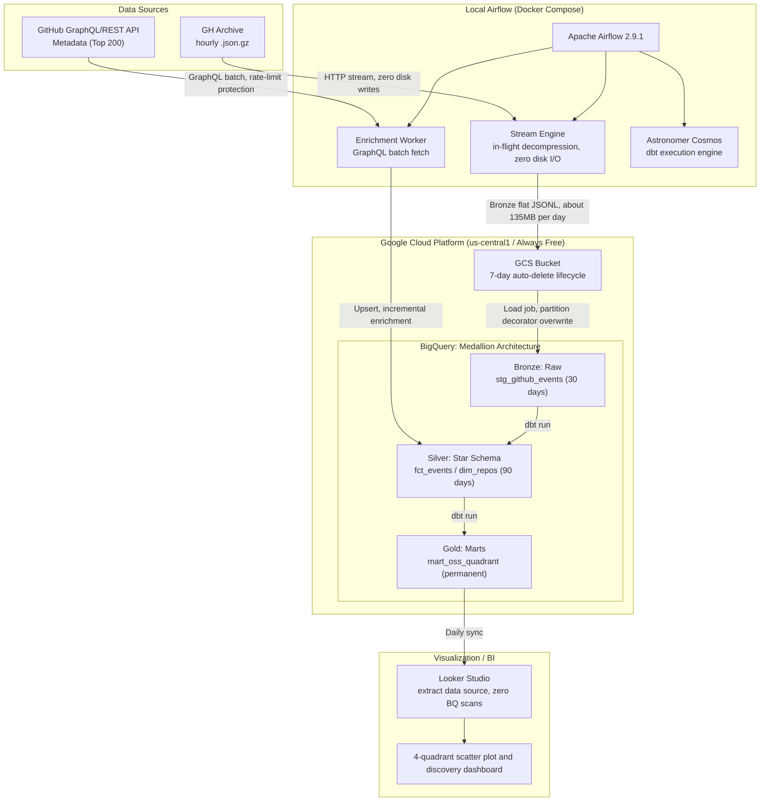

# OctoPulse: Rising-Star OSS Discovery Lakehouse 🐙⚡️

English | [日本語](README.ja.md)

OctoPulse is a data lakehouse that scans the public event stream of GitHub Archive to **detect repositories that suddenly start gaining traction (rising-star OSS) at an early stage**.

Instead of ranking by cumulative stars, it scores repositories on two percentile axes based on the open source metrics standard **CHAOSS**: **Attention Velocity** (how fast attention spreads) and **Engagement Depth** (how deeply the project is actually used and developed). This separates short-lived social media hype from genuinely fast-growing OSS.

---

## 1. System Architecture



---

## 2. Core Principles and Always Free Guardrails

* **Zero-cost operation (NFR-001)**:
  * All resources run in `us-central1`, which is covered by the free tier.
  * Temporary files in GCS are deleted automatically after 7 days.
  * Payload projection reduces the daily output from about 7.5GB to **about 135MB**.
  * BigQuery storage stays under 10GB by expiring partitions automatically: Bronze after 30 days, Silver after 90 days.
* **In-flight streaming with zero disk I/O (NFR-003)**:
  * Data is decompressed, extracted, and projected in memory and uploaded directly to GCS, without filling the Airflow container's local disk (measured: 4.48MB RAM, 0 bytes written to disk).
* **Keyless authentication (NFR-002)**:
  * No static service account JSON keys are issued. GitHub Actions uses Workload Identity Federation (WIF), and local runs mount ADC credentials.

---

## 3. Project Overview

| Component          | Role                                                                             | Location                                                               | Design reference                                                                                                                                                |
| :----------------- | :------------------------------------------------------------------------------- | :--------------------------------------------------------------------- | :-------------------------------------------------------------------------------------------------------------------------------------------------------------- |
| **Infrastructure** | GCS, BigQuery datasets, WIF, and IAM on the GCP Always Free tier                 | [`terraform/`](terraform/)                                             | [`BD-001`](docs/design/BD-001_基本設計書.md)                                                                                                                    |
| **Ingestion**      | Streams GH Archive files, projects payloads, and uploads Bronze JSONL to GCS     | [`src/octopulse/ingestion/`](src/octopulse/ingestion/)                 | [`DD-001`](docs/design/DD-001_Ingestionエンジン詳細設計書.md)                                                                                                   |
| **Bronze load**    | Loads JSONL from GCS into BigQuery Bronze with a partition decorator overwrite   | [`airflow/dags/gh_stream_ingest.py`](airflow/dags/gh_stream_ingest.py) | [`DD-004`](docs/design/DD-004_オーケストレーション詳細設計書.md)                                                                                                |
| **Modeling**       | dbt medallion models (staging, Silver star schema, Gold mart)                    | [`dbt/`](dbt/)                                                         | [`DS-001`](docs/design/DS-001_データ構造仕様書.md)                                                                                                              |
| **Enrichment**     | Fetches repository metadata via GitHub GraphQL and upserts it into Silver        | [`src/octopulse/enrichment/`](src/octopulse/enrichment/)               | [`DD-002`](docs/design/DD-002_Enrichment詳細設計書.md)                                                                                                          |
| **Orchestration**  | Daily Airflow DAG that runs ingestion, enrichment, and dbt via Astronomer Cosmos | [`airflow/`](airflow/)                                                 | [`DD-004`](docs/design/DD-004_オーケストレーション詳細設計書.md)                                                                                                |
| **BI**             | Looker Studio dashboard on an extract data source of `mart_oss_quadrant`         | Looker Studio                                                          | [`BD-001`](docs/design/BD-001_基本設計書.md)                                                                                                                    |
| **Verification**   | Scripts that check ingestion and modeling against real data                      | [`scripts/`](scripts/), [`tests/`](tests/)                             | [`TEST-001`](docs/test/TEST-001_Ingestionストリーミング実データ検証報告書.md) to [`TEST-003`](docs/test/TEST-003_Bronzeフラット形式出力の実データ検証報告書.md) |

Work items and progress are tracked in [GitHub Issues](https://github.com/xzyozi/gh-archive-lakehouse/issues).

---

## 4. Documentation (SSOT)

Project documents are written in Japanese.

* **Basic design**: [`docs/design/BD-001_基本設計書.md`](docs/design/BD-001_基本設計書.md) - overall architecture, non-functional requirements, and security policy
* **Data structure specification**: [`docs/design/DS-001_データ構造仕様書.md`](docs/design/DS-001_データ構造仕様書.md) - medallion table definitions and the finalized CHAOSS two-axis formulas
* **Detailed design**:
  * [`docs/design/DD-001_Ingestionエンジン詳細設計書.md`](docs/design/DD-001_Ingestionエンジン詳細設計書.md) - internals of the ingestion streaming engine
  * [`docs/design/DD-002_Enrichment詳細設計書.md`](docs/design/DD-002_Enrichment詳細設計書.md) - control flow of metadata enrichment via GitHub GraphQL
  * [`docs/design/DD-004_オーケストレーション詳細設計書.md`](docs/design/DD-004_オーケストレーション詳細設計書.md) - control flow of the daily pipeline with Airflow and Cosmos
* **Architecture Decision Records (ADR)**:
  * [`ADR-001: Document governance and SSOT`](docs/adr/001-document-governance-and-ssot.md)
  * [`ADR-002: Bronze ingestion format and RepoAge derivation`](docs/adr/002-ingest-repository-create-event.md)
* **Real-data verification reports**:
  * [`TEST-001: Ingestion streaming with real data`](docs/test/TEST-001_Ingestionストリーミング実データ検証報告書.md)
  * [`TEST-002: CHAOSS modeling thresholds with real data`](docs/test/TEST-002_CHAOSSモデリング閾値の実データ検証報告書.md)
  * [`TEST-003: Bronze flat output format with real data`](docs/test/TEST-003_Bronzeフラット形式出力の実データ検証報告書.md)

---

## 5. Quick Start

### Local Python checks
```bash
# Install dependencies
python3 -m venv .venv
source .venv/bin/activate
pip install -e ".[dev]"

# Unit tests and documentation checks
pytest
python .github/scripts/validate_docs.py

# Try real-data ingestion extraction (one hour of data)
python scripts/verify_ingestion_stream.py 2024-01-03 0
```

### Provision infrastructure with Terraform
```bash
cd terraform
cp terraform.tfvars.example terraform.tfvars
# Set project_id in terraform.tfvars
terraform init
terraform plan
terraform apply
```

### Start Airflow locally
```bash
cd airflow
cp .env.example .env
# Set GCP_PROJECT_ID and GCS_BUCKET_NAME in .env
docker compose up -d
# http://localhost:8080 (admin / change-me)
```
