# OctoPulse: 未知の新星OSS発掘レイクハウス 🐙⚡️

GitHub Archive の膨大な公開イベントから、**突如バズを起こした急浮上リポジトリ（未知の新星OSS）を早期検知・発掘**するためのデータレイクハウス基盤です。

単なる累計Star数ではなく、オープンソース指標標準「**CHAOSS**」に基づき、**「Attention Velocity（注目の拡散力）」×「Engagement Depth（実利用・開発定着度）」**の2軸によるパーセンタイル評価を行い、一過性のSNSバズと真の急成長OSSを分離・識別します。

---

## 1. システムアーキテクチャ

```mermaid
flowchart TD
    subgraph Source ["データソース"]
        GHA["GH Archive<br/>毎時 .json.gz"]
        GHAPI["GitHub GraphQL/REST API<br/>Metadata (Top 200)"]
    end

    subgraph Pipeline ["ローカル Airflow 基盤 (Docker Compose)"]
        Airflow["Apache Airflow 2.9.1"]
        StreamEngine["Stream Engine<br/>インフライト解凍 ＆ ゼロディスクI/O"]
        EnrichTask["Enrichment Worker<br/>GraphQL バッチ取得"]
        Cosmos["Astronomer Cosmos<br/>dbt 実行エンジン"]

        Airflow --> StreamEngine
        Airflow --> EnrichTask
        Airflow --> Cosmos
    end

    subgraph GCP ["Google Cloud Platform (us-central1 / Always Free)"]
        GCS["GCS Bucket<br/>7日自動削除 Lifecycle"]

        subgraph BigQuery ["BigQuery: メダリオンアーキテクチャ"]
            Bronze["Bronze: Raw<br/>stg_github_events (30日)"]
            Silver["Silver: Star Schema<br/>fct_events / dim_repos (90日)"]
            Gold["Gold: Marts<br/>mart_oss_quadrant (恒久)"]
        end
    end

    subgraph Visualization ["可視化・BI"]
        Looker["Looker Studio<br/>抽出データソース (BQスキャン0)"]
        Dashboard["4象限マトリクス散布図 ＆ 発掘ダッシュボード"]
        Looker --> Dashboard
    end

    GHA -->|HTTP Stream / ディスク書込0| StreamEngine
    StreamEngine -->|BronzeフラットJSONL (日次約135MB)| GCS
    GCS -->|Load Job (パーティションデコレータ上書き)| Bronze
    Bronze -->|dbt run| Silver
    Silver -->|dbt run| Gold
    EnrichTask -->|Upsert 差分補完| Silver
    GHAPI -->|GraphQL Batch レート保護| EnrichTask
    Gold -->|1日1回同期| Looker
```

---

## 2. コア方針と Always Free ガードレール

* **完全0円運用の死守 (NFR-001)**:
  * リージョンを無料枠対象の `us-central1` に統一。
  * GCS 一時ファイルは 7日後自動削除。
  * ペイロード射影により日次出力量を約 7.5GB から **約 135MB** へ圧縮。
  * BigQuery ストレージは Bronze 30日 / Silver 90日のパーティション自動破棄で 10GB 以内を維持。
* **ディスク I/O ゼロのインフライトストリーミング (NFR-003)**:
  * Airflow コンテナのローカルディスクを圧迫せず、メモリ上で解凍・抽出・射影して直接 GCS へアップロード（実測: RAM 4.48MB、ディスク書込 0 bytes）。
* **キーレス認証 (NFR-002)**:
  * サービスアカウントの固定 JSON キーを一切発行せず、GitHub Actions は Workload Identity Federation (WIF)、ローカルは ADC マウントで運用。

---

## 3. ロードマップと開発進捗

```mermaid
flowchart LR
    P0["Phase 0: 設計・実データ検証<br/>【完了】"]:::done --> P1["Phase 1: Terraform IaC<br/>【完了】"]:::done
    P1 --> P2["Phase 2: BQ Bronze Load<br/>【実装済み】"]:::done
    P2 --> P3["Phase 3: dbt モデリング<br/>【実装済み】"]:::done
    P3 --> P4["Phase 4: API Enrichment<br/>【未着手】"]:::todo
    P4 --> P5["Phase 5: Cosmos E2E統合<br/>【実装中】"]:::current
    P5 --> P6["Phase 6: Looker Studio BI<br/>【未着手】"]:::todo

    classDef done fill:#d4edda,stroke:#28a745,stroke-width:2px;
    classDef current fill:#cce5ff,stroke:#004085,stroke-width:2px;
    classDef todo fill:#f8f9fa,stroke:#6c757d,stroke-dasharray: 5 5;
```



| フェーズ    | 概要                                          |                    状態                     | 成果物・参照先                                                                                                                                                                                                                                             |
| :---------- | :-------------------------------------------- | :-----------------------------------------: | :--------------------------------------------------------------------------------------------------------------------------------------------------------------------------------------------------------------------------------------------------------- |
| **Phase 0** | 基本・詳細・データ設計および実データ検証      |                  **完了**                   | [`BD-001`](docs/design/BD-001_基本設計書.md), [`DS-001`](docs/design/DS-001_データ構造仕様書.md), [`TEST-001`](docs/test/TEST-001_Ingestionストリーミング実データ検証報告書.md)〜[`003`](docs/test/TEST-003_Bronzeフラット形式出力の実データ検証報告書.md) |
| **Phase 1** | Terraform による GCP Always Free インフラ構築 |                  **完了**                   | [`terraform/`](terraform/) (GCS, BigQuery, WIF, 契約テスト)                                                                                                                                                                                                |
| **Phase 2** | GCS から BigQuery Bronze へのロード処理       |    実装済み (実機検証は Phase 5 で実施)     | `airflow/dags/gh_stream_ingest.py` (Load Job 連携)                                                                                                                                                                                                         |
| **Phase 3** | dbt メダリオンモデリング (Silver / Gold)      |    実装済み (実機検証は Phase 5 で実施)     | [`dbt/`](dbt/) (stg, fct, dim, mart_oss_quadrant)                                                                                                                                                                                                          |
| **Phase 4** | GitHub API メタデータ補完 (Enrichment)        |                   未着手                    | Top 200 リポジトリ GraphQL バッチ取得                                                                                                                                                                                                                      |
| **Phase 5** | Airflow × Astronomer Cosmos E2E 統合          | **実装中** (DAG 組み込み済み、実機検証待ち) | [`DD-004`](docs/design/DD-004_オーケストレーション詳細設計書.md), `airflow/dags/gh_stream_ingest.py`                                                                                                                                                       |
| **Phase 6** | Looker Studio ダッシュボード構築              |                   未着手                    | 4象限バブルチャート・抽出データソース                                                                                                                                                                                                                      |

---

## 4. ドキュメント体系 (SSOT)

* **基本設計書**: [`docs/design/BD-001_基本設計書.md`](docs/design/BD-001_基本設計書.md) - 全体アーキテクチャ、非機能要件、セキュリティ方針
* **データ構造仕様書**: [`docs/design/DS-001_データ構造仕様書.md`](docs/design/DS-001_データ構造仕様書.md) - メダリオンテーブル定義、確定した CHAOSS 2軸モデリング計算式
* **詳細設計書**:
  * [`docs/design/DD-001_Ingestionエンジン詳細設計書.md`](docs/design/DD-001_Ingestionエンジン詳細設計書.md) - Ingestion ストリーミング内部仕様
  * [`docs/design/DD-004_オーケストレーション詳細設計書.md`](docs/design/DD-004_オーケストレーション詳細設計書.md) - Airflow × Cosmos による日次パイプラインの制御仕様
* **アーキテクチャ決定記録 (ADR)**:
  * [`ADR-001: ドキュメントガバナンスとSSOT`](docs/adr/001-document-governance-and-ssot.md)
  * [`ADR-002: Bronze取り込み形式とRepoAge導出`](docs/adr/002-ingest-repository-create-event.md)
* **実データ検証報告書**:
  * [`TEST-001: Ingestionストリーミング実データ検証報告書`](docs/test/TEST-001_Ingestionストリーミング実データ検証報告書.md)
  * [`TEST-002: CHAOSSモデリング閾値の実データ検証報告書`](docs/test/TEST-002_CHAOSSモデリング閾値の実データ検証報告書.md)
  * [`TEST-003: Bronzeフラット形式出力の実データ検証報告書`](docs/test/TEST-003_Bronzeフラット形式出力の実データ検証報告書.md)

---

## 5. クイックスタート

### Python ローカル検証
```bash
# 依存パッケージインストール
python3 -m venv .venv
source .venv/bin/activate
pip install -e ".[dev]"

# 単体テストおよびドキュメント検証
pytest
python .github/scripts/validate_docs.py

# 実データ Ingestion 抽出の動作確認 (1時間分)
python scripts/verify_ingestion_stream.py 2024-01-03 0
```

### Terraform インフラ構築
```bash
cd terraform
cp terraform.tfvars.example terraform.tfvars
# terraform.tfvars に project_id を入力
terraform init
terraform plan
terraform apply
```

### Airflow ローカル起動
```bash
cd airflow
cp .env.example .env
# .env の GCP_PROJECT_ID, GCS_BUCKET_NAME を設定
docker compose up -d
# http://localhost:8080 (admin / change-me)
```
