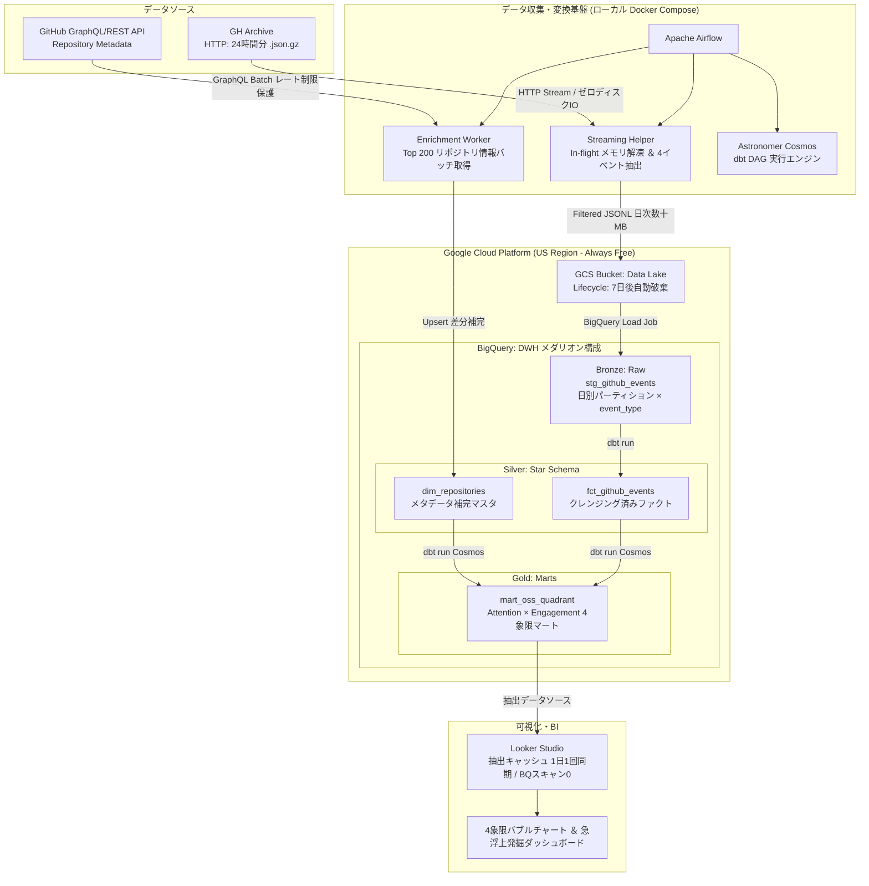

# 基本設計書（基本仕様・システム全体アーキテクチャ定義）
**OctoPulse: CHAOSS準拠 未知の新星OSS発掘レイクハウス**

---

## 1. 概要と基本方針

### 1.1 システム目的と対象範囲

本システムは、GitHubの全公開イベント履歴（GH Archive）から、**「突如バズを起こした急浮上リポジトリ（未知の新星OSS）」を早期検知・発掘**するためのデータレイクハウスである。
単なるStar数の合算ではなく、Linux Foundation傘下のオープンソース指標標準「CHAOSS」の思想を取り入れ、**「Attention Velocity（注目の拡散速度）」×「Engagement Depth（実利用・開発の定着深度）」**の2軸によるパーセンタイル評価を行う。これにより、一過性のSNSバズと、開発コミュニティが実際に定着している真の急成長OSSを分離・識別する。

- **対象範囲**:
  - GH Archive（毎時.json.gz）からのインフライトストリーミング収集・フィルタリング
  - Google Cloud Storage (GCS) をデータレイクとした短期ステージング（7日自動破棄）
  - BigQuery におけるメダリオンアーキテクチャ（Bronze / Silver / Gold）およびスタースキーマ構築
  - GitHub REST/GraphQL APIによる急浮上リポジトリのメタデータ補完（Enrichment）
  - dbt（Astronomer Cosmos連携）によるCHAOSS 2軸パーセンタイル評価モデルの変換・テスト
  - Looker Studio による4象限マトリクス散布図および発掘ダッシュボードの提供
  - Terraform による Always Free 枠内インフラのIaC構築
  - Workload Identity Federation (WIF) および Application Default Credentials (ADC) によるキーレス認証
- **対象外範囲**:
  - 非公開（Private）リポジトリの分析
  - リアルタイム秒単位のストリーミング（日次バッチによる分析を採用）
  - 外部向け商用有料APIの提供（ポートフォリオおよびオープンなBI公開に特化）
- **利用者・外部システム**:
  - **利用者**: OSSトレンドを調査するエンジニア、技術選定担当者、OSSコントリビューター
  - **外部連携先**: GH Archive (HTTP Data Source), GitHub GraphQL/REST API, Google Cloud (GCS, BigQuery, IAM/WIF), Looker Studio
- **前提・制約**:
  - **完全0円運用の死守**: Google Cloudの Always Free 枠内（GCS 5GB、BigQuery 10GBストレージ / 1TBクエリ月間）で永続運用する。
  - **ディスクI/Oゼロ**: Airflowワーカーのローカルディスクを圧迫しないよう、解凍・抽出はすべてインフライト（メモリ上ストリーム）で完結させる。
  - **認証情報保護**: サービスアカウントの固定JSONキーを永続発行せず、WIFおよびADCマウントで完結させる。
- **主要な非機能要件**:

| ID | 区分 | 要件 | 目標値・基準 | 測定方法・確認先 | 正本 |
| :--- | :--- | :--- | :--- | :--- | :--- |
| NFR-001 | コスト | Google Cloud Always Free枠を超過しない（完全0円運用） | 月額 0 円（予算アラート 1 円検知 0 件） | GCP 請求コンソール / 予算アラート | 本書 |
| NFR-002 | セキュリティ | サービスアカウントの固定JSONキーをリポジトリおよびホストに保持しない | 固定キー発行数 0 件（WIF / ADC 100%） | GCP IAM 管理画面 / CIシークレット設定 | 本書 |
| NFR-003 | リソース効率 | Ingestion時のホスト・コンテナ内ローカルディスク書き込みゼロ | ディスク書込 0 bytes、メモリ消費 512MB 以下 | Airflow タスク実行メトリクス | 本書 |
| NFR-004 | 冪等性・保守性 | 同一日付の再実行時に重複なく同一結果を保証（Backfill耐性） | 再実行時の差分 0 件、テスト通過率 100% | dbt test / Airflow 実行ログ | 本書 |
| NFR-005 | API保全 | GitHub API の利用枠を枯渇させない | 日次消費 200 requests 以下（上限 5,000 req/h の 5% 未満） | Airflow Enrichment 実行ログ | 本書 |
| NFR-006 | BIスキャン遮断 | Looker Studio 閲覧時の BigQuery スキャン量を完全遮断 | ダッシュボード閲覧時の BQ スキャン 0 bytes | BigQuery クエリ履歴（抽出キャッシュ利用） | 本書 |

### 1.2 アーキテクチャ基本原則と課題解決

| # | 課題・ボトルネック | 優先度 | 解決方針・選定技術 | 選定理由・トレードオフ | 担当コンポーネント | 関連文書 |
| :--- | :--- | :---: | :--- | :--- | :--- | :--- |
| 1 | GH Archive の生データが数TB規模で巨大 | 高 | インフライトストリーミング ＆ 4イベント（Watch, Fork, Issue, PR）限定抽出 | ローカル保存を排除し、日次抽出後サイズを数十MBに圧縮。他イベントを捨てるトレードオフはあるが、新星検知シグナルとして十分。 | Airflow Ingestion | 本書 2.1 |
| 2 | クラウドストレージおよびクエリの課金リスク | 高 | GCS 7日ライフサイクル ＋ BQパーティション・クラスタリング ＋ クエリ上限ガードレール | Always Free枠を物理的に死守。dbt に `maximum_bytes_billed: 1GB` を強制設定。長期生ログ保持を諦め、集約Goldマートのみ長期保存。 | GCS / BigQuery / dbt | 本書 3.2 |
| 3 | Star工作・ノイズによるパーセンタイル評価の歪み | 高 | アクティビティスクリーニング ＋ CHAOSS 2軸評価 ＋ 異常値フラグ | 「Watch >= 3 かつ (Fork+Issue+PR) >= 1」を母集団とし、`is_suspicious_star_surge` フラグを付与して除外可能に設計。 | dbt (Silver/Gold) | 本書 2.2 |
| 4 | GitHub API のレートリミット（5,000回/時）枯渇 | 中 | 急浮上 Top 200 件の絞り込み ＋ GraphQL API バッチ取得 ＋ 既存マスタ差分判定 | REST API の1件ずつ取得を避け、GraphQLで1リクエストあたり複数リポジトリ情報を取得。API消費を数十回に圧縮。 | Airflow Enrichment | 本書 2.2 |
| 5 | CI/CD およびローカル環境の認証キー漏洩リスク | 高 | GitHub Actions WIF 連携 ＋ ローカル Docker Compose ADC 読取専用マウント | 固定 JSON キーを完全に撲滅。初期設定の手間はあるが、エンタープライズ水準の安全性を確保。 | Terraform / Docker Compose | 本書 3.2 |
| 6 | オーケストレーションと変換のブラックボックス化 | 中 | Airflow × Astronomer Cosmos による dbt 統合 | BashOperator による一括実行を避け、dbt モデルおよびテストを Airflow 上で視覚的に追跡・部分リトライ可能にする。 | Airflow / dbt (Cosmos) | 本書 2.1 |

### 1.3 本書のSSOT範囲と文書境界

- **本書の正本範囲**: `system_architecture`。システム全体の目的、アーキテクチャ、責務境界、横断的ポリシー、セキュリティおよび0円運用設計を定義する。
- **詳細設計との境界**: 関数シグネチャ、ストリーミング内部バッファ制御、DTO定義、エラーハンドリングの具象仕様は詳細設計書（DD）を正本とする。
- **データ構造仕様との境界**: テーブルスキーマ（カラム名、データ型、パーティションキー）、JSONLレイアウトはデータ構造仕様書（DS）を正本とする。
- **全体ルール**: 文書分類、Frontmatter、ライフサイクル規約は [`docs/README.md`](../README.md) を正本とする。

---

## 2. システム全体アーキテクチャとコンポーネント分離

### 2.1 全体構造とデータフロー (Mermaid アーキテクチャ図)

### 2.2 コンポーネント責務マッピング

| コンポーネントID | コンポーネント名 | 担当領域・主要責務 | 依存先・依存方向 / 公開インターフェース | 関連詳細設計書 |
| :--- | :--- | :--- | :--- | :--- |
| `C-INGEST` | Ingestion Engine | 前日24時間分のGH ArchiveをHTTPストリーム受信し、メモリ上で即座に解凍。4大イベント（Watch, Fork, Issue, PR）のみを抽出し、GCSへJSONLとして直接アップロード。ローカルディスク書き込み0 bytesを保証。 | 依存先: GH Archive, GCS IF: Python Generator / GCS Streaming Client | DD-001 (予定) |
| `C-LAKE` | Data Lake (GCS) | Ingestionされた日次Filtered JSONLの一時蓄積。配置後7日で自動削除するライフサイクルルールによりストレージ無料枠（5GB）を永続維持。 | 依存先: Google Cloud Storage IF: GCS API / BigQuery External URI | DS-001 (予定) |
| `C-ENRICH` | API Enrichment | 前日のイベント集計に基づき、Star急伸上位200件のリポジトリを特定。GitHub GraphQL APIを用いて言語・トピック・開設日・説明文を一括取得し `dim_repositories` へマージ。 | 依存先: BigQuery, GitHub API IF: GraphQL Query / Airflow Task | DD-002 (予定) |
| `C-TRANSFORM` | Transformation (dbt) | Bronze（Raw生ログ）からSilver（ファクト・ディメンション）、Gold（4象限マート）への段階的変換。パーセンタイル正規化、異常値検知フラグ付与、dbt testによる品質検証。 | 依存先: BigQuery IF: dbt CLI / Astronomer Cosmos | DD-003 (予定) |
| `C-ORCHESTRATE` | Airflow & Cosmos | 日次パイプラインのスケジューリング、リトライ制御、Backfill管理。dbtモデル群をネイティブなタスクツリーとして展開・可視化。 | 依存先: Docker Compose, BigQuery, GCS IF: Airflow DAG Web UI | DD-004 (予定) |
| `C-INFRA` | Infrastructure (IaC) | GCSバケット、BigQueryデータセット、WIF設定、IAMロールのプロビジョニング。ステートはGCSバックエンドで管理。 | 依存先: Google Cloud Provider IF: Terraform HCL | DD-005 (予定) |
| `C-BI` | Looker Studio BI | Gold層（`mart_oss_quadrant`）に接続し、4象限バブルチャートおよびドリルダウンダッシュボードを可視化。抽出キャッシュによる課金防止。 | 依存先: BigQuery Gold Mart IF: Looker Studio Connector | DD-006 (予定) |

---

## 3. 動作前提およびシステム境界

### 3.1 実行前提環境

- **対応OS**: macOS (Darwin), Linux (Ubuntu), WSL2 (Windows Subsystem for Linux)
- **ランタイム要件**:
  - Python: `>= 3.10`（ローカル検証・開発）
  - Node.js: `>= 20.x`（GitHub Actions Mermaid/CI検証用）
  - Docker & Docker Compose: `>= 2.20`（Airflow実行環境）
  - Terraform: `>= 1.5.0`（インフラ構築）
- **依存管理・パッケージマネージャーの正本**:
  - Python: `pyproject.toml`（Ruff, pytest, mypy）
  - Airflow: `docker-compose.yaml` 内の環境変数および公式イメージ
  - dbt: `dbt-bigquery`, `astronomer-cosmos`
- **外部依存ツール**: Google Cloud SDK (`gcloud`), GitHub CLI (`gh`)
- **実行エントリポイント**:
  - インフラ構築: `terraform -chdir=terraform apply`
  - パイプライン起動: `docker compose up -d`
- **品質目標・品質ゲート**:
  - CI自動テスト（Ruff, SQLFluff, Markdown/Mermaid検証）が全パスすること。
  - dbt test（`not_null`, `unique`, `accepted_values`, カスタムパーセンタイルテスト）が全パスすること。

### 3.2 安全回路・システム境界方針

- **外部アクター・外部システム**:
  - GH Archive: パブリックなHTTPファイル配布エンドポイント（読み取り専用）。
  - GitHub API: Personal Access Token (PAT) による認証付きアクセス（レートリミット: 5,000 req/h）。
  - Google Cloud: USリージョン内にすべてのリソース（GCS, BigQuery）を配置し、リージョン間転送課金を物理的に排除。
- **入出力と信頼境界**:
  - GH Archiveの生データは第三者入力として扱い、パース時にJSON構文エラーや未知のイベント構造があってもパイプライン全体を落とさず、安全にスキップ・ログ記録する。
- **認証・認可境界**:
  - **本番 CI/CD (GitHub Actions)**: Workload Identity Federation (WIF) を利用し、短命OIDCトークンでGCPと連携。サービスアカウントキーは一切発行しない。
  - **ローカル開発環境**: ホスト上で `gcloud auth application-default login` を実行し、取得したADC資格情報（JSON）をコンテナ内 `/home/airflow/.config/gcloud` に読み取り専用（`:ro`）でマウント。ローカル環境内にも固定キーを保持しない。
- **タイムアウトと再試行制御**:
  - HTTPストリームダウンロード: タイムアウト 60 秒、最大リトライ 3 回（指数バックオフ）。
  - GitHub GraphQL API: タイムアウト 30 秒、最大リトライ 3 回。
  - BigQuery Load Job: タイムアウト 300 秒。
- **排他制御・競合防止 (Idempotency)**:
  - BigQuery Bronzeロードは `WRITE_TRUNCATE`（対象パーティション単位の上書き）を採用し、再実行時に重複レコードが発生しない設計とする。
  - Silverの `dim_repositories` は `MERGE` 文（Upsert）による最新値更新。
- **失敗時保全契約 (Zero Cost Guardrail)**:
  - BigQueryの `maximum_bytes_billed` を 1,073,741,824 bytes (1GB) に固定し、誤ったクエリによるスキャン課金を強制停止。
  - GCP 予算アラートを 1 円（0.01 USD）で設定し、意図しない課金発生時に即時通知。
- **機密情報・監査ログ方針**:
  - リポジトリに認証情報（PAT、APIキー、JSONキー）を含めない（`.gitignore` 徹底およびPre-commitチェック）。
  - 監査ログはGCP Cloud Audit Logs（無料枠内）に準拠。

---

## 4. 基本設計における変更管理方針

- **拡張時のルール**:
  - 新たな分析指標を追加する場合、Bronze/Silver層の変更は最小限に留め、Goldマート（dbt model）の追加・改修で対応する。
  - イベント種別を4種（Watch, Fork, Issue, PR）から追加する場合は、GCSファイルサイズとBigQueryストレージへの影響を再計算し、事前にADRを起票すること。
- **仕様の決定権 (SSOT)**:
  - システム全体の目的、構成、横断規約は本書を正本とする。
  - コンポーネント内部の詳細仕様は詳細設計書（DD）、テーブルスキーマはデータ構造仕様書（DS）を正本とする。
  - 文書全体の分類・ライフサイクルは [`docs/README.md`](../README.md) を参照する。
- **変更影響の確認方法**:
  - PR作成時に GitHub Actions（ドキュメント検証・Mermaid検証・CI）を実行し、壊れがないことを機械的に検証する。

---

## 5. 作成完了チェック

- [x] 対象範囲・対象外範囲・利用者・前提を記入した。
- [x] 主要な非機能要件を表に記入し、各要件に目標値・測定方法・正本を設定した。
- [x] `document_role`、`ssot_scope`、`status`、`owner` をFrontmatterへ設定した。
- [x] 課題ごとに優先度、選定理由、トレードオフ、担当、関連文書を記入した。
- [x] Mermaid図のノード名・ラベルを実際の構成へ置換し、構文を確認した。
- [x] 全コンポーネントの責務、依存方向、公開インターフェース、詳細設計書リンクを記入した。
- [x] 実行環境、依存管理の正本、品質目標（CI/dbt test）を記入した。
- [x] 外部システム、信頼境界、認証・認可、失敗時保全を記入した。
- [x] 未置換の `[ ... ]`、`YYYY-MM-DD`、サンプル固有名が残っていない。

---

## 6. 改訂履歴 (Change Log)

| 版数 | 改訂日 | 変更者 | 変更内容・変更理由 (Why) |
| :--- | :--- | :--- | :--- |
| Rev.1.0 | 2026-11-01 | xzyozi | 新規作成（初版制定: Issue #2 対応） |
