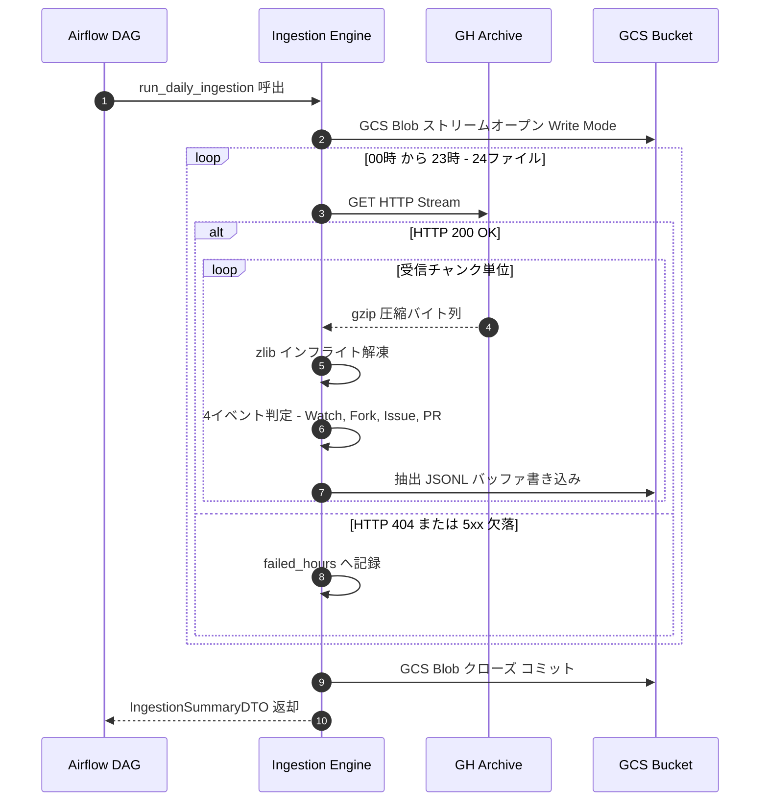

# 詳細設計書（機能・モジュール制御仕様）
**OctoPulse: Ingestion エンジン（インフライトストリーミング ＆ ゼロディスクI/O制御仕様）**

---

## 1. 概要とSSOT境界

### 1.1 モジュールの目的

本モジュール（`octopulse.ingestion`）は、GH Archive（`https://data.gharchive.org/`）から前日24時間分のイベントアーカイブ（`.json.gz`）を取得し、**ホストやコンテナのローカルディスクに一切保存せず、メモリ上でオンザフライ解凍・フィルタリングを行い、Google Cloud Storage (GCS) へ直接アップロードする「ゼロディスクI/O」Ingestionパイプライン**を提供する。

### 1.2 単一責任範囲 (SSOT) とデータ境界

- **本書の正本範囲**: `module_behavior`。ストリーミング受信、インフライト解凍、イベント抽出ジェネレータ、GCSアップロード制御フロー、およびエラーリトライ契約の正本とする。
- **データ境界 (DTO vs DAO)**: 本書はモジュール内部で扱うメモリ上DTOを管理する。GCS物理JSONL形式およびBigQueryスキーマは [`DS-001_データ構造仕様書.md`](./DS-001_データ構造仕様書.md) を正本とする。
- **基本設計書（BD）との関係**: 全体アーキテクチャおよび非機能要件（NFR-003: ディスク書込 0 bytes）は [`BD-001_基本設計書.md`](./BD-001_基本設計書.md) を正本とし、本書はその制御仕様を具体化する。

---

## 2. インターフェースと DTO 仕様

### 2.1 対象機能一覧

| 機能ID | 関数・機能名 | 呼び出し元 | 主な呼び出し先 | 同期 / 非同期 | 冪等性 | 外部副作用 | 公開範囲 |
| :--- | :--- | :--- | :--- | :---: | :---: | :--- | :---: |
| `F-ING-001` | `fetch_hourly_stream` | `run_daily_ingestion_to_writer` | GH Archive (HTTP) | 同期 | あり | なし（読取のみ） | 内部 |
| `F-ING-002` | `extract_target_events` | `run_daily_ingestion_to_writer` | Python Generator | 同期 | あり | なし（メモリ上純粋処理） | 内部 |
| `F-ING-003` | `build_gcs_blob_path` | `run_daily_ingestion` | なし（純粋関数） | 同期 | あり | なし | 内部 |
| `F-ING-004` | `run_daily_ingestion` | Airflow PythonOperator | `F-ING-003`, `005` | 同期 | あり | GCS 日次JSONL上書き作成 | 外部公開 |
| `F-ING-005` | `run_daily_ingestion_to_writer` | `run_daily_ingestion` / テスト | `F-ING-001`, `002` | 同期 | あり | 渡された Writer へのストリーム出力 | 外部公開 |

---

### 2.2 主要関数の契約ブロック

#### ① 機能ID: `F-ING-004` `run_daily_ingestion`（日次バッチ実行エントリポイント）

- **関数識別名**: `run_daily_ingestion`
- **機能概要**: 対象日のGH Archive 24時間分をGCS Blobへ直接ストリームオープンして抽出し、JSONLとして上書き保存する。
- **事前条件**: `gcs_bucket_name` が有効であり、実行環境（ADC）にGCS書き込み権限があること。
- **事後条件**: 抽出イベントが指定のGCSパス（`gs://<bucket>/raw/YYYY/MM/DD/events_YYYYMMDD.jsonl`）に永続化され、ローカルファイルへの書き込みが0 bytesであること。
- **外部副作用**: 対象GCSオブジェクトの上書き作成（再実行時の冪等性担保）。

##### 入力 DTO スキーマ・パラメータ仕様
| パラメータ名 | データ型 | 必須性 | NULL可 | デフォルト値 | 説明・制約 |
| :--- | :--- | :---: | :---: | :--- | :--- |
| `target_date` | `datetime.date` | 必須 | 不可 | なし | 処理対象日（前日UTC日付） |
| `gcs_bucket_name` | `str` | 必須 | 不可 | なし | アップロード先GCSバケット名 |
| `storage_client` | `storage.Client` | 任意 | 可 | `None` | GCS クライアントインスタンス（未指定時は自動生成） |
| `hours` | `list[int]` | 任意 | 可 | `None` | 処理対象時間リスト（未指定時は `0..23` の全24時間） |

##### 出力 DTO スキーマ・戻り値仕様
| フィールド | データ型 | 必須性 | NULL可 | 正常時の意味・制約 |
| :--- | :--- | :---: | :---: | :--- |
| `target_date` | `datetime.date` | 必須 | 不可 | 処理完了対象日 |
| `gcs_uri` | `str` | 必須 | 不可 | 出力先GCSオブジェクトパス |
| `total_events_extracted` | `int` | 必須 | 不可 | 抽出された4イベント総数（>= 0） |
| `total_bytes_uploaded` | `int` | 必須 | 不可 | GCSアップロード総バイト数 |
| `processed_hours` | `list[int]` | 必須 | 不可 | 正常処理された時間リスト（0〜23） |
| `failed_hours` | `list[int]` | 必須 | 不可 | 欠落・取得失敗した時間リスト |
| `status` | `str` | 必須 | 不可 | `SUCCESS` / `PARTIAL_SUCCESS` / `FAILED` |

---

#### ② 機能ID: `F-ING-005` `run_daily_ingestion_to_writer`（ストリーム書き込みコア関数）

- **関数識別名**: `run_daily_ingestion_to_writer`
- **機能概要**: 任意の `TextWritable`（`blob.open('w')` や `StringIO`）に直接インフライト抽出データを流し込むテスタブルなコア関数。
- **引数**:
  - `target_date: datetime.date`: 対象日
  - `writer: TextWritable`: 書き込み先ストリーム
  - `destination_uri: str`: 送信先の識別URI
  - `hours: list[int] | None`: 対象時間（デフォルト `0..23`）
- **戻り値**: `IngestionSummaryDTO`
- **外部副作用**: `writer.write` へのデータ書き込み

---

#### ③ 機能ID: `F-ING-002` `extract_target_events`（インフライト抽出ジェネレータ）

- **関数識別名**: `extract_target_events`
- **引数**: `byte_stream: Iterator[bytes]`（HTTP圧縮ストリームのバイト列イテレータ）
- **戻り値**: `Iterator[dict[str, Any]]`（抽出イベントの辞書イテレータ）
- **処理規約**:
  - `byte_stream` を受け取り、`zlib.decompressobj(wbits=31)` を用いてチャンク単位でインフライト解凍する。
  - 行区切り（`\n`）でバッファリングし、完全な行になったJSON文字列をパースする。
  - `type` が対象4種（`WatchEvent`, `ForkEvent`, `IssuesEvent`, `PullRequestEvent`）に合致する場合のみ `yield` する。
  - 不正・破損行による `JSONDecodeError` はログに警告記録してスキップし、パイプラインを停止させない。

---

## 3. 処理フローおよびアルゴリズム

### 3.1 処理手順 (Mermaid シーケンス図)

---

### 3.2 ゼロディスクI/O メモリ制御アルゴリズム

1. **ストリーム解凍**:
   - `gzip.GzipFile` はファイルライクオブジェクトを要求するため、ローカルファイルを作らない場合は `zlib.decompressobj(wbits=31)` を使用する。
   - `31`（`16 + zlib.MAX_WBITS`）を指定することで、Gzipヘッダーとトレイラーを自動認識してストリーム解凍を行う。
2. **GCSストリーミングアップロード**:
   - `google.cloud.storage.Blob.open("w")`（または `resumable_upload` ストリーム）を使用し、解凍・フィルタした文字列を即座にGCSライターへ流し込む。
   - メモリ使用量はチャンクバッファ（約8MB〜16MB）のみで一定推移し、OOM（Out Of Memory）を完全に防止する。

---

### 3.3 エラーハンドリング・リトライ制御

| 発生事象 | 原因 | 対処方針・制御規約 |
| :--- | :--- | :--- |
| **HTTP 5xx / ネットワーク断** | GH Archive一時障害 | 指数バックオフ付きで最大3回リトライ（待機: 5s, 15s, 45s）。 |
| **HTTP 404** | 未生成・アーカイブ欠落 | リトライを2回行い、なお404の場合は欠落時間として記録し、次時間の処理へ継続。 |
| **JSONDecodeError** | 不正文字・破損行 | 破損行をWarningログに記録し破棄。次行のパースへ進む。 |
| **GCS書き込みエラー** | GCP認証切れ・権限不足 | 即時例外送出（Fatal）。Airflowタスクを失敗させて通知。 |

---

## 4. 変更管理方針

- 抽出対象イベントを追加する場合は、`extract_target_events` 内の判定リスト（Set）を更新し、対応するBigQuery Bronze層への影響を確認する。
- ストリーミング解討ロジックの変更時は、メモリ使用量プロファイリング（`tracemalloc` 等）による検証を必須とする。

---

## 5. 作成完了チェック

- [x] 機能一覧表に対象関数、入出力、冪等性、副作用を記載した。
- [x] 主要関数の入力・出力DTO、事前・事後条件を定義した。
- [x] Mermaidシーケンス図を作成し、構文を確認した。
- [x] メモリ上ストリーム解凍（`zlib`）のアルゴリズムを明記した。
- [x] エラーハンドリング表に対処方針を定義した。
- [x] 未置換のプレースホルダが残っていない。

---

## 6. 改訂履歴 (Change Log)

| 版数 | 改訂日 | 変更者 | 変更内容・変更理由 (Why) |
| :--- | :--- | :--- | :--- |
| Rev.1.0 | 2026-11-01 | xzyozi | 新規作成（初版制定: Issue #4 対応） |
| Rev.1.1 | 2026-11-01 | xzyozi | 実装(gcs_uploader.py)に合わせて run_daily_ingestion の引数(storage_client, hours)および run_daily_ingestion_to_writer 契約を追加・同期（Issue #11 対応） |
