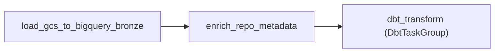

# 詳細設計書（機能・モジュール制御仕様）
**OctoPulse: Enrichment（GitHub GraphQL によるメタデータ補完の制御仕様）**

---

## 1. 概要とSSOT境界

### 1.1 目的

`BD-001` の `C-ENRICH` を具体化する。その日の Star 数が多いリポジトリ上位 200 件について、言語・トピック・説明文・開設日・累計 Star/Fork を GitHub GraphQL API から取得し、`repo_metadata` へ書き込む。dbt の `dim_repositories` がこれを結合し、Mart の `primary_language` / `topics_display` / `repo_age_days` に反映される。

### 1.2 SSOT境界

- **本書の正本範囲**: `module_behavior`。対象選定、API 取得、書き込み手順、エラー処理、DAG 上の位置。
- **本書が正本としないもの**: `repo_metadata` / `dim_repositories` のスキーマは `DS-001`、DAG 全体の構成とリトライ方針は `DD-004`、非機能要件（NFR-004 / NFR-005）は `BD-001` を正本とする。
- **実装の正本（予定）**: `src/octopulse/enrichment/`、`airflow/dags/gh_stream_ingest.py`。

### 1.3 決定状況

本書は Issue #38 の壁打ちの結果を反映する。**確定**は回答済みの項目、**暫定**は Issue に書いた推奨案のまま、回答を得ていない項目である。暫定項目は、回答により変わりうる。

| 項目 | 状態 | 内容 |
| :--- | :---: | :--- |
| Q1 書き込み主体 | 確定 | Enrichment 専用の `repo_metadata`（Airflow だけが書く）を新設し、`dim_repositories` は dbt が結合して作る |
| Q2 補完範囲 | 確定 | 上位 200 件のまま進める。妥当性は Issue #39 で検証する |
| Q9 DAG 上の位置 | 確定 | 案 3: Bronze の当日パーティションから Enrichment が上位 200 件を直接選び、補完後に dbt 全体を実行する（2.1 節） |
| Q10 書き込み方法 | 確定 | JSONL を GCS に置き、ステージングへロードして `MERGE` する（5 節） |
| Q3 再取得の間隔 | 暫定 | 7 日以内に更新済みのリポジトリはスキップし、次点を繰り上げて 200 件を埋める |
| Q4 累計 Star/Fork | 暫定 | `repo_metadata` に残す。取得時点の値であり、日次の新規 Star ではない |
| Q5 GraphQL の設計 | 暫定 | 50 件/クエリ、`rateLimit` を毎回取得、`description` は 1,000 文字で切る |
| Q6 認証 | 暫定 | 読み取り専用の fine-grained PAT を `airflow/.env` の `GITHUB_TOKEN` で渡す |
| Q7 エラー処理 | 暫定 | 6 節 |
| Q8 冪等性 | 暫定 | NFR-004 の例外とする（6.3 節） |
| Q11 実装の配置 | 暫定 | `src/octopulse/enrichment/`、HTTP は標準ライブラリ、テストは HTTP をモックにする |

---

## 2. DAG 上の位置

### 2.1 案 3: 上位 200 件を Bronze から直接選ぶ

- Enrichment は dbt の出力（`fct_github_events`）に依存せず、Bronze の当日パーティションだけを入力にする。そのため、`DbtTaskGroup` を分割せず、`DD-004` の構成を変えずに済む。
- 補完は dbt より前に終わるため、同じ日の Mart に言語・トピックが反映される。
- 上位 200 件の選定ロジックが dbt の外にもう 1 か所できる。この重複を最小にするため、選定は 3.1 節の単純なルールに限定する。

### 2.2 位置づけの根拠

| 案 | 概要 | 採否 |
| :--- | :--- | :---: |
| 案 1 | dbt を 2 グループに分け、間に補完を挟む | 不採用（Cosmos の `select` による分割の動作が実機でないと確認できない） |
| 案 2 | 前日の補完結果を使う（1 日遅れ） | 不採用（急浮上した当日のリポジトリほど言語が空になる） |
| **案 3** | **Bronze から直接選び、補完後に dbt 全体を実行する** | **採用** |

---

## 3. 対象選定

### 3.1 候補の抽出

Bronze `stg_github_events` の当日パーティション（`event_date = ds`）を対象に、`type = 'WatchEvent'` のイベント数を `COUNT(DISTINCT id)` でリポジトリ（`repo_name`）ごとに集計し、降順に並べる。`COUNT(DISTINCT id)` は dbt の `daily_stars` の定義（論点③）と同じである。

- スキャン対象は当日の 1 パーティションのみ（実測 約 135MB/日）。ガードレールの 1GB を超えない。
- dbt の母集団の足切り（`daily_stars >= 3` かつ Fork+Issue+PR が 1 以上）は適用しない。足切りは dbt の責務で、Enrichment は単純な Star 数の順位だけを使う。
- 足切りを通らない、Star だけが突出したリポジトリも候補に入る。枠が無駄になる件数は実測が必要（Issue #39）。

### 3.2 再取得のスキップ（暫定）

`repo_metadata.metadata_updated_at` が直近 7 日以内のリポジトリは候補から除き、次点を繰り上げて合計 200 件を埋める。言語やトピックの変化は緩やかなので、毎日取り直さない。

---

## 4. GitHub GraphQL の取得（暫定）

- 1 クエリに複数リポジトリをエイリアスで束ねる。1 クエリあたり 50 件、200 件で 4 リクエスト（NFR-005 の日次 200 requests 以下を大きく下回る）。
- 各クエリで `rateLimit { remaining resetAt cost }` を取得し、残量が閾値を下回れば中断する。
- 取得項目: `primaryLanguage.name`、`repositoryTopics`（先頭 20 件）、`description`、`createdAt`、`stargazerCount`、`forkCount`。`isArchived` などは必要になってから追加する。
- `description` は保存時に 1,000 文字で切り詰める。
- 認証は読み取り専用の fine-grained PAT。トークンはログ、例外メッセージ、XCom に出力しない。

---

## 5. BigQuery への書き込み（確定）

1. 取得結果を JSONL にして GCS（`enrichment/YYYY/MM/DD/` 配下）へ置く。ローカルディスクには書かない（NFR-003）。
2. `octopulse_bronze.stg_repo_metadata` へ `WRITE_TRUNCATE` でロードする。
3. `stg_repo_metadata` から `octopulse_silver.repo_metadata` へ、`repo_name` をキーに `MERGE` する（`BigQueryInsertJobOperator`）。
4. ストリーミング挿入は使わない。

`MERGE` は DML のため、実機での確認には請求先アカウントのある GCP プロジェクトが必要（BigQuery サンドボックスは DML 非対応。Issue #32）。

---

## 6. エラー処理と冪等性（暫定）

### 6.1 部分エラー
GraphQL が一部のリポジトリを `null` で返す場合（削除・改名・非公開）は、そのリポジトリだけスキップして `repo_metadata` を更新しない。スキップ件数をログに残す。

### 6.2 致命的エラー
認証エラー、レート制限の枯渇、5xx は、タスクを失敗させる（`retries: 3`）。部分的な結果を黙って書き込まない。

### 6.3 冪等性（NFR-004 の例外）
API の値は取得時点で変わるため、同一日付の再実行で同一結果にはならない。`MERGE` により行は重複せず、値は最新に更新される（SCD Type 1）。

### 6.4 既知の制約
`repo_name` が主キーのため、リポジトリの改名後は別のリポジトリとして扱われる。`repo_id` を主キーにする変更は対象外とする。

---

## 7. dbt への影響（実装時に反映する）

- `repo_metadata` を `sources.yml` に追加する（`<prefix>_silver.repo_metadata`）。
- `dim_repositories` を、`repo_metadata` を LEFT JOIN する構成に変更する。`repo_created_at` は `repo_metadata` の値を優先し、無ければ `CreateEvent` 由来の累積値を使う。
- `dim_repositories.metadata_updated_at` を NULLABLE にし、`schema.yml` の `not_null` テストを外す（`DS-001` Rev.1.7）。
- 現在の `dim_repositories` は、自身の既存列を引き継ぐ作りになっている。この仕組みは不要になる。

---

## 8. 未検証・範囲外

- 実装は未着手。本書は設計であり、動作は未検証。
- 実 API でのレスポンス形式、`rateLimit.cost` の実測、1 クエリあたりの最適な件数は未確認。
- 上位 200 件のカバレッジが十分かは Issue #39 で検証する。
- Terraform での `repo_metadata` / `stg_repo_metadata` の作成は、実装時に決める。

---

## 9. 改訂履歴

| 版 | 日付 | 変更者 | 変更内容 |
| :--- | :--- | :--- | :--- |
| 0.1 | 2026-11-04 | xzyozi | 新規作成（Issue #38: Q1・Q2・Q9・Q10 の決定を反映。Q3〜Q8・Q11 は暫定） |
