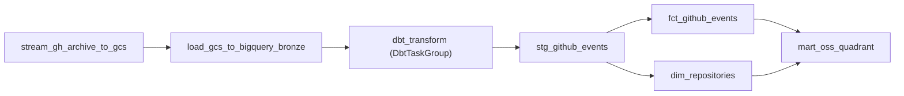

# 詳細設計書（機能・モジュール制御仕様）
**OctoPulse: オーケストレーション（Airflow × Astronomer Cosmos による日次パイプライン制御仕様）**

---

## 1. 概要とSSOT境界

### 1.1 目的

`BD-001` の `C-ORCHESTRATE` を具体化し、単一の DAG `gh_stream_ingest` で次の3段を日次実行する制御仕様を定義する。

1. GH Archive から GCS へのインフライトストリーミング（`DD-001`）
2. GCS から BigQuery Bronze への日次パーティションロード
3. dbt によるメダリオン変換（Staging → Silver → Gold）。Cosmos がモデルとテストを Airflow タスクへ展開する

### 1.2 SSOT境界

- **本書の正本範囲**: `module_behavior`。DAG のタスク構成と依存、dbt へ渡す論理日付、リトライ方針、実行環境の配線（マウント・環境変数）の正本とする。
- **本書が正本としないもの**: Bronze/Silver/Gold のスキーマと CHAOSS 計算式は `DS-001`、Ingestion の内部挙動は `DD-001`、全体アーキテクチャと非機能要件は `BD-001` を正本とする。
- **実装の正本**: `airflow/dags/gh_stream_ingest.py`、`airflow/docker-compose.yaml`、`dbt/macros/incremental_window.sql`。

---

## 2. DAG 構成

- 各 dbt モデルは `run` タスクと、直後の `test` タスクとして展開される（`TestBehavior.AFTER_EACH`）。テストが失敗したモデルの下流は実行されない。
- 個々のモデルは Airflow UI から単独でクリア・再実行できる。

### 2.1 dbt 統合の設定

| 項目 | 設定 | 理由 |
| :--- | :--- | :--- |
| 実行モード | `ExecutionMode.LOCAL` | `Dockerfile` の専用 venv（`/opt/airflow/dbt_venv`）の dbt を直接呼ぶ。Airflow と dbt の依存衝突を避ける |
| 描画方式 | `LoadMode.DBT_LS` | モデル数が少なく運用手順を増やさない。パース時間が問題になった場合は `DBT_MANIFEST` へ移行する |
| テスト | `TestBehavior.AFTER_EACH` | 不正データを下流へ流さない |
| `dbt deps` | 実行しない | `packages.yml` が無く、実行時のネットワークアクセスを避ける |
| 論理日付 | `vars: {run_date: "{{ ds }}"}` | 過去日の再実行を冪等にする（2.2節） |
| リトライ | dbt タスクは `retries: 1` | `maximum_bytes_billed` 超過やテスト失敗は再試行しても成功しない。外部サービス起因の ingest 系（3回）より少なくする |

### 2.2 冪等性（NFR-004）

dbt の増分条件は `dbt/macros/incremental_window.sql` の `incremental_window()` に集約している。

- 窓は `[run_date - lookback_days, run_date]`。下限は遅延到着イベントの取りこぼし防止、上限は過去日の再実行を冪等にするためにある。
- `run_date` は DAG から論理日付 `{{ ds }}` を渡す。未指定（手動実行）の場合は `current_date()`。
- `run_date` は SQL に埋め込むため、`YYYY-MM-DD` 形式以外はコンパイルエラーにする。
- `lookback_days` の既定は 3。`--vars '{lookback_days: 30}'` で上書きできる。
- Bronze のロードは日次パーティションの `WRITE_TRUNCATE`、Silver/Gold は `unique_key` による MERGE のため、同一日の再実行で重複しない。

---

## 3. 実行環境の配線

| 対象 | 設定 | 内容 |
| :--- | :--- | :--- |
| マウント | `../dbt:/opt/airflow/dbt:ro` | dbt プロジェクトを読み取り専用で提供する |
| マウント | `../dbt/profiles.yml.example:/opt/airflow/dbt_profiles/profiles.yml:ro` | Cosmos は `profiles_yml_filepath` の親ディレクトリを `--profiles-dir` に使うため、`profiles.yml` の名前で提供する。1GB ガードレール（`maximum_bytes_billed`）の定義を `profiles.yml.example` に一元化する |
| 環境変数 | `GCP_DATASET_PREFIX` | DAG（Bronze ロード先）と dbt（出力先データセット、source 定義）の両方が参照する。Terraform の `dataset_prefix` と一致させる |
| 環境変数 | `DBT_TARGET` | profile の target（`dev` / `prod`） |
| 環境変数 | `DBT_TARGET_PATH` / `DBT_LOG_PATH` | プロジェクトが読み取り専用のため、成果物とログを `/tmp` に出す |

認証は、ホストの ADC を読み取り専用でマウントする既存方式を使う。固定のキーファイルは発行しない（NFR-002）。

---

## 4. 検証状況

| 項目 | 状態 | 備考 |
| :--- | :---: | :--- |
| DAG の構成・依存・設定値の契約 | 検証済み | `tests/test_airflow_dag.py`（AST と文字列による静的検証） |
| 増分窓マクロの展開、`run_date` の形式検証 | 検証済み | Jinja2 でのスタブ展開で確認 |
| Cosmos での DAG 描画（`dbt ls`）、タスク展開 | **未検証** | Cosmos が未導入の環境で実装したため。イメージビルド後に確認する |
| BigQuery 上での `dbt run` / `dbt test` | **未検証** | 実機（GCP 環境と Bronze の実データ）が前提。結果は TEST-004 として記録する |
| 同一 `ds` の再実行で差分 0 件 | **未検証** | 同上 |
| 読み取り専用マウント下での dbt の動作 | **未検証** | Cosmos が一時ディレクトリへコピーする挙動と `DBT_TARGET_PATH` の組み合わせを実機で確認する |

---

## 5. 改訂履歴

| 版 | 日付 | 変更者 | 変更内容 |
| :--- | :--- | :--- | :--- |
| 0.1 | 2026-11-04 | xzyozi | 新規作成（Issue #30: Cosmos による dbt 統合の制御仕様） |
