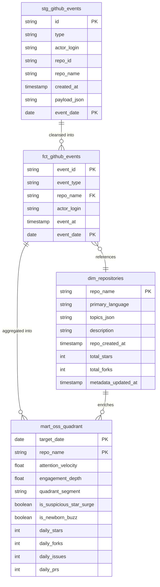

# データ構造仕様書（スキーマ・永続化・状態定義）
**OctoPulse: GCS ＆ BigQuery メダリオンデータモデリング仕様**

---

## 1. 概要とデータ管理方針

### 1.1 管理対象データの目的

本仕様書は、OctoPulseにおけるデータレイク（GCS）の一時ファイル仕様、およびデータウェアハウス（BigQuery）のメダリオンアーキテクチャ（Bronze / Silver / Gold）における物理テーブルスキーマ、パーティショニング、クラスタリングを定義する。

- **管理対象**:
  - GCS Filtered JSONL（前日24時間分の抽出済みイベントログ）
  - BigQuery Bronze層: `stg_github_events`（生ログステージングテーブル）
  - BigQuery Silver層: `fct_github_events`（イベントファクト）、`dim_repositories`（リポジトリディメンション）
  - BigQuery Gold層: `mart_oss_quadrant`（CHAOSS準拠 4象限集計マート）
- **データ形式・文字コード**: UTF-8、改行コード LF、改行区切り JSON（JSONL）
- **時刻の基準**: すべて **UTC (Coordinated Universal Time)** を基準とし、ISO 8601 形式（`YYYY-MM-DDTHH:MM:SSZ`）で保持する。
- **機密性・個人情報保護**: GH Archive上の公開アクティビティのみを扱い、利用者の個人メールアドレスや非公開情報は取得・保存しない。

### 1.2 データ境界 (DAO / 永続化ストレージ正本)

- **本書の正本範囲**: `persistent_data`。物理ストレージ（GCS）のファイル構造およびBigQueryのテーブルスキーマの正本とする。
- **基本設計書（BD）との関係**: システム全体のアーキテクチャや0円運用方針は [`BD-001_基本設計書.md`](./BD-001_基本設計書.md) を正本とし、本書はその永続化層を具体化する。
- **詳細設計書（DD）との関係**: メモリ上DTOや関数シグネチャは詳細設計書を正本とし、本書は物理保存形式を規定する。

### 1.3 テーブルおよびファイル配置仕様

| レイヤー | 配置場所 / オブジェクト名 | 保持内容 | 保持期間（リテンション） | 所有者・アクセス権 |
| :--- | :--- | :--- | :--- | :--- |
| **GCS Stage** | `gs://<bucket>/raw/YYYY/MM/DD/events_YYYYMMDD.jsonl` | 4イベント抽出済み生ログ | **7日間**（GCSライフサイクルで自動削除） | Airflow / BigQuery Load Job (IAM) |
| **Bronze (Raw)** | `octopulse_bronze.stg_github_events` | ロードされた生イベントログ | **30日間**（パーティション有効期限） | dbt / BigQuery サービスアカウント |
| **Silver (Core)** | `octopulse_silver.fct_github_events` | クレンジング済みイベントファクト | **90日間**（パーティション有効期限） | dbt / BigQuery サービスアカウント |
| **Silver (Core)** | `octopulse_silver.dim_repositories` | リポジトリマスタ（APIメタデータ補完） | 恒久保持（SCD Type 1 上書き更新） | dbt / Airflow Enrichment |
| **Gold (Marts)** | `octopulse_gold.mart_oss_quadrant` | 日次 4象限スコアマート | 恒久保持（Looker Studio 抽出ソース） | Looker Studio / 閲覧者（読取専用） |

---

## 2. データ構造およびスキーマ定義

### 2.1 エンティティ関係図 (Mermaid ER図)

---

### 2.2 GCS Filtered JSONL フォーマット

GH Archiveからインフライト抽出され、GCSに配置される改行区切りJSON（JSONL）の1行あたりのフィールド構造仕様。

| フィールドパス | データ型 | 必須性 | 説明・値の例 |
| :--- | :--- | :---: | :--- |
| `id` | `STRING` | 必須 | イベント一意識別子（例: `"33445566778"`） |
| `type` | `STRING` | 必須 | イベント種別（`"WatchEvent"`, `"ForkEvent"`, `"IssuesEvent"`, `"PullRequestEvent"`） |
| `actor.id` | `INT64` | 必須 | イベント実行ユーザーID（例: `12345`） |
| `actor.login` | `STRING` | 必須 | イベント実行ユーザー名（例: `"octocat"`） |
| `repo.id` | `INT64` | 任意 | リポジトリID（例: `67890`） |
| `repo.name` | `STRING` | 必須 | リポジトリ名（例: `"fastapi/fastapi"`） |
| `payload` | `OBJECT` | 必須 | イベント固有のJSONオブジェクト（`action`, `issue`, `pull_request` 等） |
| `public` | `BOOLEAN` | 必須 | 公開フラグ（常時 `true`） |
| `created_at` | `STRING` | 必須 | ISO 8601 UTCタイムスタンプ（例: `"2026-10-31T23:59:59Z"`） |

---

### 2.3 BigQuery Bronze層: `stg_github_events`

GCSからBigQuery Load Jobによって `WRITE_TRUNCATE` で取り込まれる生ログテーブル。

| カラム名 | データ型 | モード | 説明 |
| :--- | :--- | :--- | :--- |
| `id` | `STRING` | REQUIRED | GH Archiveイベントの一意識別子 |
| `type` | `STRING` | REQUIRED | イベント種別（WatchEvent, ForkEvent, IssuesEvent, PullRequestEvent） |
| `actor_login` | `STRING` | REQUIRED | イベント実行ユーザーのアカウント名 |
| `repo_id` | `INT64` | NULLABLE | GitHub リポジトリID |
| `repo_name` | `STRING` | REQUIRED | リポジトリフルネーム（`owner/repo`） |
| `payload` | `JSON` | REQUIRED | イベント固有のペイロード（action, issue/pr詳細など） |
| `created_at` | `TIMESTAMP` | REQUIRED | イベント発生時刻（UTC） |
| `event_date` | `DATE` | REQUIRED | **パーティションキー**（`created_at` の日付部分） |

- **パーティショニング**: `event_date` 単位（日別パーティション）
- **クラスタリング**: `repo_name`, `type`（クエリ時のスキャン量を数MB単位に削減）
- **パーティション有効期限**: 30日（Always Free 10GBの防衛）

---

### 2.4 BigQuery Silver層

#### ① `fct_github_events`（イベントファクトテーブル）
Bronzeから必要な属性を抽出し、クレンジングした正規化ファクト。

| カラム名 | データ型 | モード | 説明 |
| :--- | :--- | :--- | :--- |
| `event_id` | `STRING` | REQUIRED | イベント一意ID |
| `event_type` | `STRING` | REQUIRED | `WatchEvent`, `ForkEvent`, `IssuesEvent`, `PullRequestEvent` |
| `actor_login` | `STRING` | REQUIRED | 実行者ユーザー名 |
| `repo_name` | `STRING` | REQUIRED | 対象リポジトリ名（`dim_repositories` と結合） |
| `event_action` | `STRING` | NULLABLE | ペイロード内 action（started, opened, closed 等） |
| `event_at` | `TIMESTAMP` | REQUIRED | 発生日時（UTC） |
| `event_date` | `DATE` | REQUIRED | **パーティションキー**（日別） |

- **パーティショニング**: `event_date` 単位（日別）
- **クラスタリング**: `repo_name`, `event_type`
- **パーティション有効期限**: 90日

#### ② `dim_repositories`（リポジトリディメンションテーブル）
GH Archiveには存在しないメタデータを GitHub API から補完したマスタ。

| カラム名 | データ型 | モード | 説明 |
| :--- | :--- | :--- | :--- |
| `repo_name` | `STRING` | REQUIRED | リポジトリフルネーム（主キー） |
| `primary_language` | `STRING` | NULLABLE | 主要言語（Python, Rust, TypeScript 等） |
| `topics` | `ARRAY<STRING>` | REPEATED | リポジトリのトピックタグ配列（llm, agent, wasm 等） |
| `description` | `STRING` | NULLABLE | リポジトリの説明文 |
| `repo_created_at` | `TIMESTAMP` | NULLABLE | リポジトリ開設日（新星OSS判定に使用） |
| `total_stars` | `INT64` | NULLABLE | API取得時点の累計Star数 |
| `total_forks` | `INT64` | NULLABLE | API取得時点の累計Fork数 |
| `metadata_updated_at` | `TIMESTAMP` | REQUIRED | メタデータの最終取得更新日時 |

- **更新方針**: Airflow Enrichment タスクによる `MERGE`（SCD Type 1 上書き）

---

### 2.5 BigQuery Gold層: `mart_oss_quadrant`

Looker Studioに接続し、4象限バブルチャートを描画するための集計マート。

| カラム名 | データ型 | 説明 |
| :--- | :--- | :--- |
| `target_date` | `DATE` | 集計対象日 |
| `repo_name` | `STRING` | リポジトリ名 |
| `primary_language` | `STRING` | 主要言語（dimより補完） |
| `topics_display` | `STRING` | トピック文字列（カンマ区切り表示用） |
| `repo_age_days` | `INT64` | 開設からの経過日数 |
| `daily_stars` | `INT64` | 当日の新規Star獲得数 |
| `daily_forks` | `INT64` | 当日の新規Fork獲得数 |
| `daily_issues` | `INT64` | 当日の起票・更新Issue数 |
| `daily_prs` | `INT64` | 当日のPR作成・マージ数 |
| `attention_velocity` | `FLOAT64` | **Attention Velocity（X軸）** 正規化スコア (0.00〜1.00) |
| `engagement_depth` | `FLOAT64` | **Engagement Depth（Y軸）** 正規化スコア (0.00〜1.00) |
| `quadrant_segment` | `STRING` | **4象限セグメント名**（Hyper-Growth, Viral Spotlight, Silent Utility, Niche） |
| `is_suspicious_star_surge` | `BOOLEAN` | スパム・Bot工作疑いフラグ（Starのみ突出しFork/PRが極小） |
| `is_newborn_buzz` | `BOOLEAN` | 開設即日（7日以内）急上昇フラグ |

> [!NOTE]
> `attention_velocity` および `engagement_depth` の厳密な母集団足切り条件（スクリーニング基準）および加重計算式は、第1回実データ（Bronze生ログ）投入後にデータ分布をプロットし、dbtモデル実装時に最終確定する。

---

## 3. 永続化・パーティショニング・クラスタリング契約

1. **パーティションプルーニング**:
   - dbt変換クエリおよびマート集計クエリは、必ず `WHERE event_date = ...` を含め、対象日以外のパーティションのスキャンを完全に除外する。
2. **クラスタリング効果**:
   - `repo_name` をクラスタリングキー先頭に配置することで、特定リポジトリの時系列検索時のスキャンブロック数を最小化する。
3. **容量防壁 (Always Free 10GB死守)**:
   - Bronze層（30日破棄）＋ Silver層（90日破棄）＋ Gold層（マート永続）により、定常的なBigQueryアクティブストレージを約 2〜4 GB 程度で定常維持する。

---

## 4. 変更管理方針

- テーブル定義にカラムを追加する場合は、後方互換性を保つため `NULLABLE` で追加する。
- 破壊的変更（カラム型変更、パーティションキー変更）が必要な場合は、事前にマイグレーション計画を作成し、ADRを起票する。

---

## 5. 作成完了チェック

- [x] GCSの一時ファイル形式およびパス規約を定義した。
- [x] Bronze, Silver, Goldの物理テーブルスキーマ、型、NULL許容を定義した。
- [x] パーティショニングおよびクラスタリング設定を明記した。
- [x] Mermaid ER図を作成し、構文を確認した。
- [x] 未置換のプレースホルダが残っていない。

---

## 6. 改訂履歴 (Change Log)

| 版数 | 改訂日 | 変更者 | 変更内容・変更理由 (Why) |
| :--- | :--- | :--- | :--- |
| Rev.1.0 | 2026-11-01 | xzyozi | 新規作成（初版制定: Issue #4 対応） |
